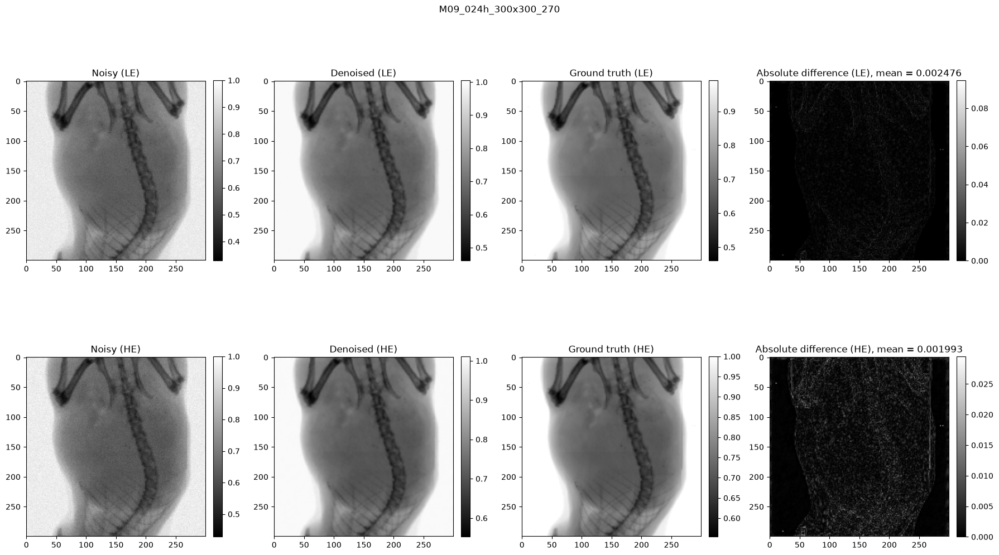

## Projection_Denoising_UNet
This repository provides a PyTorch implementation of a 2D U-Net for denoising dual-energy cone-beam CT projections in the low-energy and high-energy channels.

- [Projection Denoising UNet](#projection_denoising_unet)
  - [Overview](#overview)
  - [Contents](#contents)
  - [Installation & Setup](#installation--setup)
  - [Testing](#testing)
  - [Prepare Data](#prepare-data)
  - [Training](#training)
  - [Prediction](#prediction)
  - [Prediction Results](#prediction-results)
  - [References](#references)


### Overview
The projections in this project come from Cone-Beam Computed Tomography (CBCT) with an X-ray energy of 65 keV. They are acquired with a photon-counting detector, which sorts the detected photons into a Low Energy (LE) bin and a High Energy (HE) bin. The energy division is made at the average energy of the spectrum: photons below it are counted in the LE bin and photons above it in the HE bin.

Because X-ray photons are detected one by one, the projections are affected by Poisson noise. The aim of this project is to remove this noise with a deep learning approach. For this image-to-image translation (noisy to noiseless) task, the UNet [1] is a good candidate model.

The model used in this project is a 2D UNet with residual blocks [2], where each block has 3 convolution layers. It takes as input noisy projections with 2 channels (LE and HE) of size 300 x 300 and returns as output the denoised projection with the same shape.

This project has two modes: training and prediction.

- **Training mode:** after downloading the dataset (see [Prepare Data](#prepare-data)), you can train the model with it. Alternatively, you can skip training and use the pre-trained model which can be downloaded from this [link](https://liveunibo-my.sharepoint.com/:u:/g/personal/mohammadamin_abdoli_studio_unibo_it/IQAZhArrk4VvQ61gbn3tCHs1AUKljKbWfupxiHWrLnK51h0) which requires 140 MB of disk space.
- **Prediction mode:** the model predicts the denoised projections corresponding to the given noisy projections. The folder [prediction_dataset](./prediction_dataset) contains 12 pairs of noisy/noiseless projections that are used to evaluate the performance of the trained UNet. These 12 pairs are projections of 3 different mice that were not part of the training dataset, so they are completely new for the model.

---
### Contents
Projection Denoising UNet is composed of scripts and modules:

- Scripts train the model and make predictions with it.
- Modules define the dataset, the model, the losses and the helper functions in PyTorch.

**Script:**

All scripts are located in the [main directory](./)

| Scripts | Description |
|:----------:|:----------------|
| [training](./training.py) | Trains the model with the downloaded input and target projections, and the given number of epochs, batch size, learning rate regime and some other hyperparameters.<br>• Saves the best model based on improvement of validation loss<br>• Makes a log file of loss values during training<br>• Saves a plot of the loss history and learning rate per epoch |
| [predict](./predict.py) | Denoises noisy projections with a trained model and compares them with the ground truth.<br>• Saves the denoised projections as `.npy` files<br>• Saves a comparison picture for each projection<br>• Prints the mean absolute difference between the denoised and the ground truth projections for the LE and HE channels |

**Modules:**

All modules are located in the [libraries folder](./libs)

| **Module** | **Description** |
|:----------|:---------------|
| [dataset](libs/dataset.py) | Checks the data files and loads input/target projection pairs, train/validation split, create a batch of projections|
| [unet](libs/unet.py) | The main UNet architecture built by residual blocks (ResBlock). The UNet consists of an encoder, a bottleneck and a decoder. The encoder has 4 levels (32, 64, 128 and 256 channels) then the bottleneck (512 channels) is the deepest level of the UNet. The decoder mirrors the encoder, it has 4 levels (256, 128, 64 and 32 channels). There are skip connections concatenate the encoder features of each level to correspounding decoder. And Dropout layers are used in the deeper levels to reduce overfitting.|
| [utils](libs/utils.py) | Helper functions: device setup (use cuda or cpu), save/load checkpoints, plot histories, calculate the absolute differences between denoised and ground truth projections, plot comparisons of projections  |
| [losses](libs/losses.py) | Contains all loss functions and the denoising loss that combines all 3 loss components together:<br>• `SSIMLoss`: a class of the SSIM loss [3], 1 - SSIM, which captures structural differences between the predicted and target projections. It uses a Gaussian window (built by the `gaussian_window` function) with the given `window_size` and `sigma`, e.g. `SSIMLoss(window_size=3)(prediction, target)`<br>• `gradient_loss`: edge-preserving loss, the MSE between the gradients of the predicted and target projections<br>• `denoising_loss`: the weighted sum of the MAE, the SSIM loss (3x3 window) and the gradient loss |
| [data augmentation](libs/data_augmentation.py) | Contains the geometrical transformations (rotating and flipping functions) used for data augmentation. Data augmentation is applied only in the training process (not in validation) to expand the training dataset and reduce the risk of overfitting.|

Here is the directory structure of the repository:

- [training.py](./training.py)
- [predict.py](./predict.py)

- [prediction_dataset](./prediction_dataset)
  - [noisy projection](./prediction_dataset/noisy_projs)
  - [ground truth](./prediction_dataset/groundtruth)

- [tests](./tests)
  - [projections for testing](./tests/projections_for_testing)
  - [test_data_aug.py](tests/test_data_aug.py)
  - [test_dataset.py](tests/test_dataset.py)
  - [test_losses.py](tests/test_losses.py)
  - [test_utils.py](tests/test_utils.py)
  - [test_unet.py](tests/test_unet.py)

- [libraries](./libs)
  - [data_augmentation.py](./libs/data_augmentation.py)
  - [dataset.py](./libs/dataset.py)
  - [losses.py](./libs/losses.py)
  - [unet.py](./libs/unet.py)
  - [utils.py](./libs/utils.py)

---
### Installation & Setup
In order to use this project, navigate to the directory where you want to build the project:

```bash
cd path/to/my_projects_folder
```

and clone the repository there:

```bash
git clone https://github.com/maminabd/Projection_Denoising_UNet.git
```

Next, create a virtual environment dedicated for the project. You can create it either in the folder where you cloned the project, or
you can open a new terminal (cmd on Windows, bash on Linux) that starts from `c:/users/user_name` or `home/user_name` and create the environment there. Create the environment by using:

```bash
python -m venv denoising_env
```

Then activate the newly created environment:

**On Windows cmd:**

```bash
denoising_env\Scripts\activate
```

**On Linux and macOS:**

```bash
source denoising_env/bin/activate
```

Finally, go to the project directory:

```bash
cd Projection_Denoising_UNet
```

Install the required dependencies of this project listed in [requirements.txt](https://github.com/maminabd/Projection_Denoising_UNet/blob/main/requirements.txt) by using this command:

```bash
pip install -r requirements.txt
```

For the next sessions of working with the project, you only need to activate the environment again, from any directory, by using the path to its `activate` file.

The minimum versions of the libraries are written in [requirements.txt](./requirements.txt); the project was developed and tested with Python 3.11 on Linux and Windows 11. Once all the dependencies have been installed, the environment is ready to be used for this project.

---
### Testing
The tests are in the [tests](./tests/) directory. Each file tests the module with the corresponding name in [libs](./libs). They are written with [pytest](https://docs.pytest.org/), which is already installed via requirements.txt, and they do not require a GPU. Most of the tests generate the files they need in a temporary directory, and some of them need real projections, for which they use the mouse projections in the [projections_for_testing](./tests/projections_for_testing) folder.

To run the whole group of tests from the main repository root you need to execute:

```bash
cd Projection_Denoising_UNet
pytest ./tests/
```

To run a single test file or a single test you need to execute:

```bash
pytest tests/test_dataset.py
pytest tests/test_dataset.py::test_check_files_length_mismatch_raises
```

#### Running Tests with Coverage
Coverage is tracked with `coverage.py` and configured in [.coveragerc](./.coveragerc). To run the whole tests with the coverage from the main repository root you need to execute:

```bash
bash run_tests_coverage.sh
```

This is equivalent to:

```bash
coverage erase
coverage run --rcfile=.coveragerc -m pytest tests/
coverage report -m
coverage html
```

The terminal report lists of missing lines of each python code, and the HTML report is saved in the `htmlcov` folder, which contains three main pages:

- The [index.html](htmlcov/index.html) file contains a summary of the coverage statistics, including the percentage of each file covered by tests. You can click on each file to see a detailed view of the code, with lines highlighted to indicate which lines were executed during testing and which were not. 

- The [class_index.html](htmlcov/class_index.html) file provides a class-level view of the coverage report, showing which classes were covered by tests and which were not.

- The [function_index.html](htmlcov/function_index.html) file provides a function-level view of the coverage report, showing which functions were covered by tests and which were not.

The command-line scripts (`training.py` and `predict.py`), the tests and the functions that only display or save pictures or select the device (`get_device`, `plot_history` and `projs_comparison` in [utils](libs/utils.py)) are intentionally excluded from the coverage measurement. 

For this project, the tests cover 100% of included codes in `libs/`.

---
### Prepare Dataset
For training the UNet model, a dataset containing 2 subfolders, "input" and "target" is expected. Each subfolder should contain mouse projection `.npy` files at different angles. The `.npy` file in the "input" folder must correspond to a `.npy` file in the "target" folder with the same name.

The dataset containing 5400 pairs of projections of 15 different mice can be downloaded from this [link](https://liveunibo-my.sharepoint.com/:u:/g/personal/mohammadamin_abdoli_studio_unibo_it/IQCQOj_Bmr09QbBFEW7XAaVLASqEqncbQQq4b3usm4rdPyU). When the download is finished, a `.tar.xz` file called "training_dataset" with size 2.7 GB is created in the download directory. Navigate to that directory:

```bash
cd path/to/download/directory
```

Then decompress the file with the following command (note that the decompressed training_dataset folder needs 7.2 GB of disk space):

```bash
tar -xvf training_dataset.tar.xz
```

Each `.npy` file is a CBCT projection of a mouse in frontal (coronal) plane, with shape `(300, 300, 2)`. The last axis is the two channels: index 0 is LE (Low Energy projection) and index 1 is HE (High Energy projection). All projections are already normalized to the `[0, 1]` range. The `float32` (32-bit floating point numbers) format was chosen for projection files because PyTorch works natively with it (it is the default data type of its tensors and models, so no further conversions are needed), and it gives a good precision for the intensities in `[0, 1]` for its size, using half of the memory of `float64`.

---
### Training
When the dataset is ready, we can train the model with the [training script](./training.py). The path to the training_dataset directory is required.

```bash
python training.py --dataset "path/to/training_dataset" 
```

You can also set the following training hyperparameters or options:

- Epochs (--epochs): default value 100

- Batch size (--batch): default value 8

- Save a checkpoint every N epochs (--save_model_every): default value 25

- Plot training history every N epochs (--plot_every): default value 5

- Path to checkpoint (.pth) to continue training from (--resume)

- Check if the dataset is valid for training (--check_dataset). If you omit this option, the code skips checking the dataset (default), and if you add --check_dataset with any variable e.g. --check_dataset 1, it runs the check_dataset which may take some time. If check_dataset confirms the dataset for the first training, --check_dataset can be omitted for subsequent trainings.

Run `python training.py --help` to see the full list of training options.


Here are some examples for training:

For the first training:

```bash
python training.py --dataset "path/to/training_dataset" --check_dataset 1
```

To continue training from a checkpointed model:

```bash
python training.py --dataset "path/to/training_dataset" --epochs 200 --resume UNet_epoch_025.pth
```

To monitor save the results of training more frequently, you can set lower values for plot_every and save_model_every.


```bash
python training.py --dataset "path/to/training_dataset" --plot_every 5 --save_model_every 10
```

The remaining settings (learning rate, scheduler parameters and validation fraction) are constants at the top of [training.py](training.py). The random seeds are fixed (`SEED` in [training.py](training.py)), so a training is replicable.

---
### Prediction
Once a UNet model with is trained, we can use it to denoise unseen mouse projections with the same Poisson noise that the training dataset projections have. To do so, run the [predict script](./predict.py), which requires path to the folder of noisy projections, path to the folder of the corresponding noiseless ground truth for the evaluation and path to the trained model file (.pth). The following command denoises the projection samples provided in [prediction_dataset folder](./prediction_dataset) using a trained model.

```bash
python predict.py --noisy ./prediction_dataset/noisy_projs --groundtruth ./prediction_dataset/groundtruth --model ./UNet_best.pth
```

The [predict.py](./predict.py) saves the denoised projections in the output directory and also compares the denoised projections with the noiseless ones and saves the comparison results as a picture. For this, you can also set the directory where denoised `.npy` files and the comparison pictures are saved by using `--output`  (default: `--output ./predicted_results`).

---
#### Prediction Results

The 12 pairs of projections in [prediction_dataset](./prediction_dataset) were denoised with the trained model. The mean absolute difference between the denoised and the ground truth projections, averaged over the 12 evaluation files, is: 


| **Channel** | **Mean absolute difference** |
|:-----------:|:----------------------------:|
| LE (Low Energy) | 0.001755 |
| HE (High Energy) | 0.001585 |

The projections are normalized to the `[0, 1]` range, so these values are very small compared to the intensity range.

---
#### Example Output

Below is a sample output of [predict.py](./predict.py). It shows the denoised projection of a mouse (second column) for both the low energy (top row) and high energy (bottom row) channels, along with the given noisy projection (first column), the ground truth projection which is noiseless (third column) and the absolute difference map (fourth column).

<p align="center">
  
</p>

---


### References
<blockquote>[1] - Olaf Ronneberger, Philipp Fischer, and Thomas Brox. UNet: Convolutional Networks for Biomedical Image Segmentation. 2015. doi: 10.1007/978-3-319-24574-4_28.
</blockquote>

<blockquote>[2] - Kaiming He, Xiangyu Zhang, Shaoqing Ren, and Sun Jian. Deep residual learning for image recognition. In Proceedings of the IEEE Conference on Computer Vision and Pattern Recognition, pages 770–778, 2016.
</blockquote>


<blockquote>[3] - Zhou Wang, Alan C. Bovik, Hamid R. Sheikh, and Eero P. Simoncelli. Image Quality Assessment: From Error Visibility to Structural Similarity. IEEE Transactions on Image Processing, 13(4):600–612, 2004. doi: 10.1109/TIP.2003.819861.
</blockquote>
